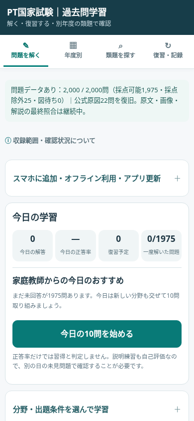
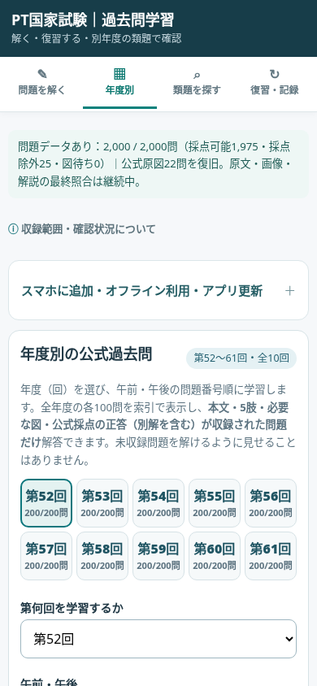
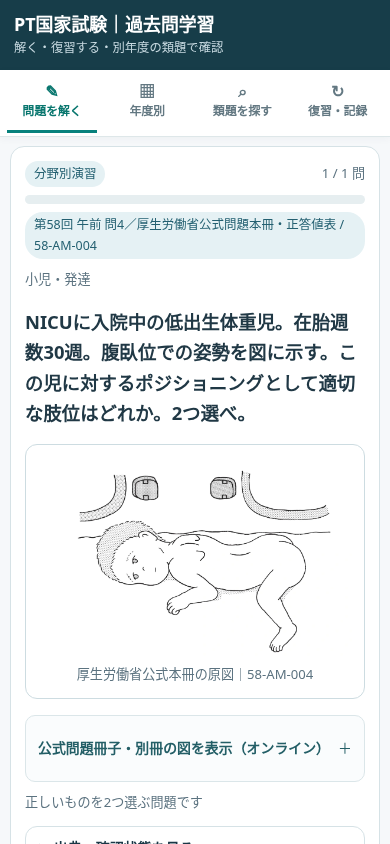
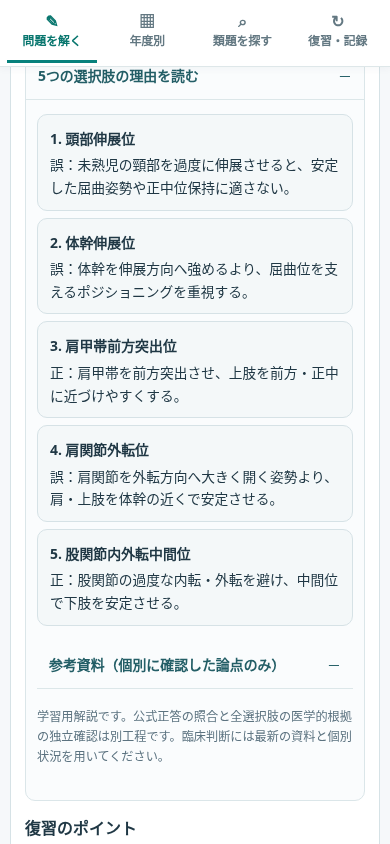

# PT国家試験 過去問学習アプリ

**第52〜61回／全2,000問**を題材に、分野別演習・年度別演習・復習・知識の深掘り・関連過去問の学習を行う静的Webアプリです。GitHubで以前から運用してきた `pt-study` の継続版です。**別アプリへの作り直しではありません。**

## 現在の画面（v129・ローカル動作確認）

| ホーム／学習開始 | 年度別演習 |
|---|---|
|  |  |

| 図を使う設問 | 解答後の5肢解説 |
|---|---|
|  |  |

> これらはGitHub公開前にローカルのChromium（幅390px）で撮影した画面です。オンラインの公開URLがこの状態に更新されたことを示すものではありません。個人の学習履歴は撮影用の新規プロフィールなので含まれません。

## 操作

「**問題を解く**」から今日の10問／分野別ランダム、「**年度別**」から各年度の午前・午後100問を順に学習できます。解答後は、要点・折りたたみ式の5肢解説・知識の深掘り・別年度の関連過去問・復習評価を利用できます。「**復習・記録**」から学習記録をJSONでバックアップできます。

## データの状態

|項目|v129での状態|
|---|---|
|試験範囲|第52〜61回／2,000問|
|採点対象|1,975問|
|公式採点除外|25問（通常の採点対象にしない）|
|収録画像ファイル|286点|
|今回特定した原図未収録・差し替え22問|v127までにアプリへ収録、ブラウザ表示を確認|
|5肢別解説の登録|262問（残り1,738問は未登録）|
|知識接続の分析対象|123問|
|関連過去問リンク|167件|

**未完了**：全2,000問の公式紙面との逐字照合、図の正確性に関する全面的な独立確認、全5肢の医学的説明の精査、全問題の知識接続の作成。登録済みと検証済みを混同しないでください。第53回の一部に二次資料から採録した内容がある旨の旧版注意書きは、照合完了まで維持しています。

## GitHubへの反映

1. **既存の `sinkintosoymilk-ctrl/pt-study` を使います**。新しいリポジトリは作成しません。
2. GitHub Desktopなどで同リポジトリをローカルに取得し、**このREADME.mdと同じ階層の `index.html`、`assets/`、`css/`、`data/`、`js/`、`sw.js` など全ファイル**をリポジトリのルートへコピーします。
3. 差分を確認して `Update PT study app to v129: original figures and learning explanations` などのメッセージでコミットし、`main`（あるいは実際に公開利用しているブランチ）へPushします。
4. GitHub PagesまたはCloudflare Pagesに反映されたら、同じURLを使った表示と学習履歴を確認してください。

**注意：** HTMLだけの更新は不可です。画像286点と`data/`・`js/`全体が必要です。フォルダの階層を変えないでください。ZIPファイルそのものをリポジトリに置いてもWebアプリは更新されません。

公開URL・ブラウザ・保存領域が同じなら、従来の学習記録は原則残りますが、更新前にアプリの「復習・記録」からJSONを書き出してください。`localStorage` の削除やリセット操作は不要です。学生のバックアップJSONはGitHubにコミットしないでください。

[詳細な更新履歴](CHANGELOG.md) · [現状と未完了事項](docs/PROJECT_STATUS.md) · [公開前チェック](docs/RELEASE_CHECKLIST.md) · [検証結果](docs/release-validation.json)

## 構成

- `index.html` / `css/app.css` — 既存の学習画面
- `data/questions.js` — 2,000問・公式正答・採点例外などの既存問題データ（v128から**変更なし**）
- `data/related.js` / `data/knowledge-v121.js` — 関連問題・知識の深掘り
- `data/rationales.js` / `data/rationale-expansion-v128.js` — 解説データ
- `assets/figures/` / `data/figure-manifest.json` — 画像とオフライン利用の一覧
- `js/` — 演習、学習履歴、図表示、年度別、知識接続など
- `sw.js` — オフラインキャッシュ（今回v129へ更新）

本アプリは教育用の試験対策資料です。医療現場での判断を代替するものではありません。
